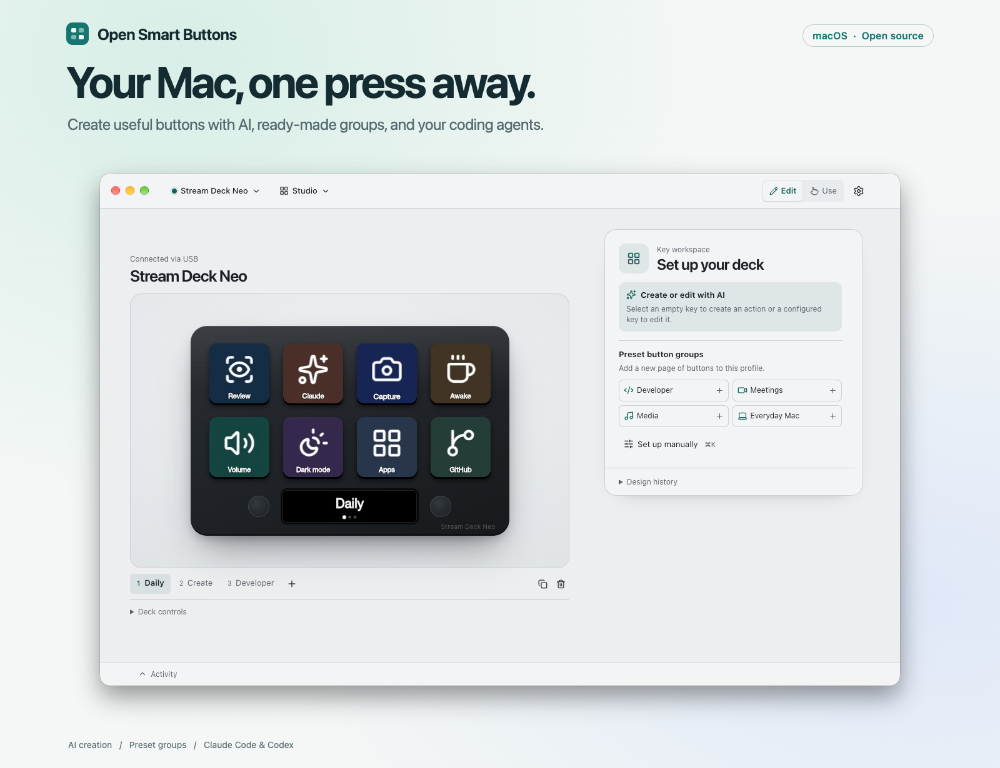
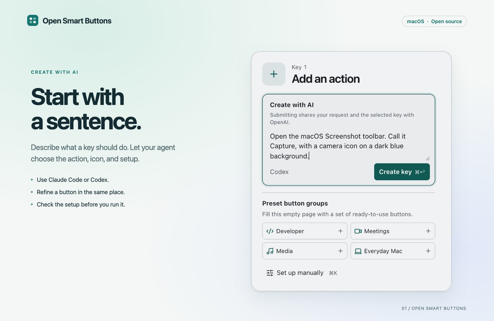
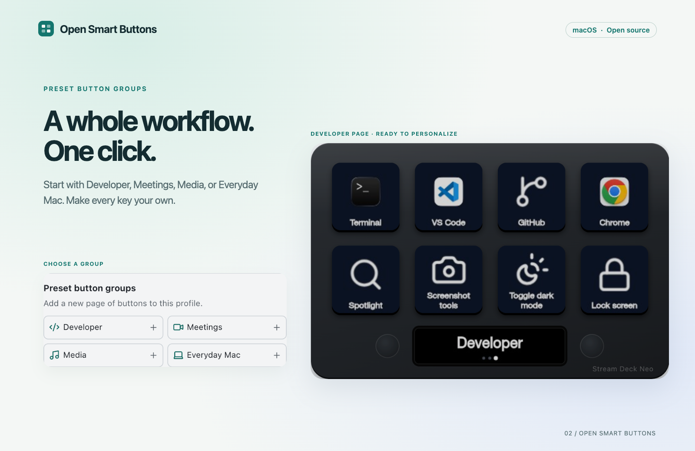
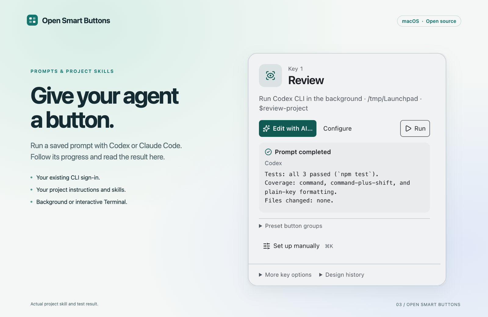
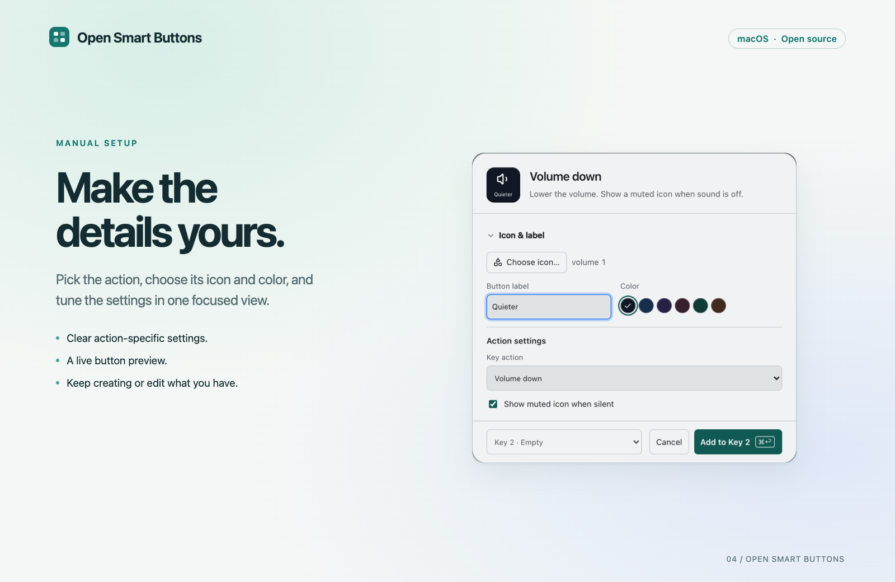

# Open Smart Buttons

A macOS-first controller and editor for **Stream Deck Neo** and **Stream Deck +**, without the Stream Deck app. A local service talks to the deck over USB, and the editor runs on your Mac. Nothing leaves your Mac unless you ask for it.

Create buttons in plain language, start with a ready-made group, or give a coding agent a prompt to run on demand.

<picture>
  <source media="(prefers-color-scheme: dark)" srcset="docs/images/screenshots/workspace-dark.png">
  <source media="(prefers-color-scheme: light)" srcset="docs/images/screenshots/workspace-light.png">
  
</picture>

[See all screenshots and the capture plan](docs/SCREENSHOTS.md).

Open Smart Buttons is an independent project, not affiliated with or endorsed by Elgato or Corsair. Stream Deck is a trademark of Corsair Memory, Inc. Hardware and library names identify compatibility and attribution; they are not the project's brand.

## Open Smart Buttons for Mac

Download the DMG for your Mac (Apple silicon or Intel) from the [Releases page](https://github.com/jimmyhzhang/open-smart-buttons/releases) and drag Open Smart Buttons to Applications. macOS 13 or later.

The first launch walks you through plugging in the deck and, optionally, letting keys press shortcuts on your Mac. After that, Open Smart Buttons lives in the menu bar: switch profiles, change brightness, pause Mac actions, or open the editor. Closing the editor window keeps your deck working.

- **Elgato Stream Deck is open?** Only one app can use the deck. Choose **Quit It and Connect** in the menu bar or the editor.
- **Keys that press shortcuts** need Accessibility and Automation access for Open Smart Buttons. Open **Settings ▸ Permissions** to check and grant them.
- **Settings** (⌘,) holds Open at login, Show in menu bar, device brightness and sleep, AI (Claude Code, Codex or an API key), and updates.

To build the app yourself, see [the desktop app guide](docs/DESKTOP.md).

## Create and edit with AI



Select a key and describe what it should do in **Create with AI** or **Edit with AI**. Open Smart Buttons sends your request and the selected key to an AI engine and validates the returned settings, icon and state rules before saving. Generated scripts are syntax-checked and run only when you press the key. AI design runs when you submit it, including while Mac actions are paused.

If you're signed in to [Claude Code](https://claude.com/claude-code) or [Codex](https://github.com/openai/codex), there's nothing to set up: Open Smart Buttons uses your existing sign-in and plan. It runs the CLI once per design with no tools, no MCP servers and no saved session. **Automatic** (the default) uses Claude Code, then Codex, then an Anthropic API key, whichever is ready first.

- In the app, choose the engine and check sign-in in **Settings ▸ AI**. An optional Anthropic API key is encrypted with your Mac's Keychain and never shown to the editor.
- From Terminal, set `OPEN_SMART_BUTTONS_AI` to `claude`, `codex` or `api` to pick one. For the API key, launch with `ANTHROPIC_API_KEY` and `OPEN_SMART_BUTTONS_CLAUDE_MODEL` in the environment. The key is never passed to the CLIs or to your commands.

## Start with a preset group



Choose **Developer**, **Meetings**, **Media**, or **Everyday Mac** under **Preset button groups**. An empty page fills with the group; otherwise, a new page is added. Select any key to personalize it with AI or **Configure**. Some actions need their target app installed or Mac permissions before they can run.

## Prompt buttons



Choose **Set up manually → Run prompt with Claude** or **Run prompt with Codex**, enter a prompt, and choose the project folder. You can also ask **Create with AI** to make this button. Saving never runs the prompt; pressing the key does. The executor on the button is independent of the AI engine used to design it.

**Background** runs with your CLI sign-in and project instructions, shows progress and the final response in the key workspace, and offers **Stop task**. Repeated presses while running reuse that task. Include `$skill-name` for Codex or start with `/skill-name` for Claude Code to invoke a skill installed for that project or user. **Terminal** opens an interactive session when a task needs approvals or follow-up. Background execution keeps normal CLI permissions; Codex uses its workspace sandbox. A permission denial is reported as a failure with guidance to use Terminal.

Tasks stop if you disconnect the device, remove the action, pause Mac actions, or quit the service. The last 20 task results are held in memory until the service quits. Simulator tests never launch an agent.

## Fine-tune a button manually



1. Select a key or dial and choose **Set up manually** (⌘K). Pick an action type and action, or search for what you need.
2. Choose the icon, label and color, complete the action's settings, and save. Use **Configure** to edit it later or press the virtual key in **Use** mode to simulate it. To run Mac effects from a USB deck, enable **Perform actions from USB decks on this computer** in Settings.
3. Use **More key options** to change a button's look with Mac state. For example, show a crossed-out speaker when muted or a different icon while a chosen app is running.

Use the device menu to disconnect or reconnect. On Neo, the two touch points can switch pages or adjust volume. Profiles support pages, folders, and model-specific controls. Some Mac controls require Accessibility or Automation consent for the app that launched Open Smart Buttons. Use the permission prompt in Settings to check access.

The editor can import Open Smart Buttons JSON and Elgato profile archives. Existing external actions stay in the profile and are identified as unavailable when selected. PNG and JPEG images within the upload limits are supported. Replace legacy images in other formats to show them on the deck again. Back up the whole data directory when moving profiles and images to a new machine.

## Run from Terminal

Install Node.js 22.18 or later. Set up the checkout once.

```sh
npm ci
npm run build:ui
```

Double-click `run.command` or run it from Terminal. It opens the editor in your browser with a temporary session credential. If the browser is closed, use the launch link printed in Terminal. Keep that link private. Restarting rotates the credential. The Terminal version and the app share the same data folder, so run one at a time.

The normal launcher uses the built assets and installed dependencies. Setup may download packages. Stop any older Open Smart Buttons server before upgrading an existing data directory. If the official app holds the USB handle, quit it yourself and select **Reconnect** in the device menu.

| Command | Purpose |
| --- | --- |
| `npm run app:dev` | Start the Mac app from source. |
| `npm run sim` | Launch a simulator with USB and Mac effects off. The saved USB execution preference is preserved. Open the printed link. |
| `npm run doctor` | Read permissions and key mappings from the running editor (the app or Terminal version). Add `-- --listen` to see input for 30 seconds. For another server, pass its `--port` and `--data` values. |
| `npm run probe` | Optional USB diagnostic that claims the device, changes brightness, and paints a test pattern. Stop other apps that use the deck first. |
| `npm run verify` | Run TypeScript checks, automated tests, and the production build. |

## Network and data

The editor and device service communicate over loopback (`127.0.0.1`). Outbound requests come from these explicit actions:

- **AI design**, only when you submit one: Claude Code (Anthropic) or Codex (OpenAI) through your own sign-in, or `api.anthropic.com` with an API key over a fixed TLS destination that rejects redirects.
- **Your actions.** Keys you set up can open websites, apps and links, and run commands, scripts, Shortcuts and AI prompts. Coding agents load their own project settings, skills and configured tools. They run only when you press them, with your user account's permissions.
- **Updates** (the project's GitHub Releases), only in the Mac app, only when you click **Check for Updates** or turn on **Check automatically** (off by default). Updates are signature-checked before they install.

Commands and scripts run in your login shell's `PATH`, so tools from Homebrew or `~/.local/bin` work from the Mac app too. To allow only built-in deck, volume and Mac controls, start the Terminal version with `OPEN_SMART_BUTTONS_LOCAL_ONLY=1`.

By default the data directory is `~/.open-smart-buttons`. It holds profiles, images, and the last 20 AI jobs. Use **Design history → Clear design history** to remove the job records and their undo history. Profile exports can contain prompts, snippets, and local paths. Review them before sharing. The Mac app keeps its preferences and the encrypted API key in `~/Library/Application Support/Open Smart Buttons` and its log in `~/Library/Logs/Open Smart Buttons`. See [release and recovery instructions](docs/RELEASE.md), [the desktop app guide](docs/DESKTOP.md) and [contributor setup](docs/CONTRIBUTING.md).

Existing installations keep using their previous data and preference folders when no new-name folder exists. This preserves profiles, images, scripts, AI history and the service lock without copying a live store. New `OPEN_SMART_BUTTONS_*` environment variables take precedence over legacy launch variables. If macOS cannot unlock a previously saved API key after the app identity changes, Settings ▸ AI asks you to re-enter it; the encrypted file stays in place. macOS may also require fresh Accessibility or Automation consent for the renamed app.

## Hardware scope

The Neo has been used with a physical device. The Stream Deck + simulator exercises its key, dial, and touch-strip paths at the HID report layer. Other recognized models share parts of the driver and need separate physical validation before claiming release support.

## Acknowledgments

Thanks to the maintainers and contributors of
[python-elgato-streamdeck](https://github.com/abcminiuser/python-elgato-streamdeck) and
[rust-elgato-streamdeck](https://github.com/OpenActionAPI/rust-elgato-streamdeck) for their open-source
work supporting Stream Deck hardware.

## License

Open Smart Buttons is available under the [MIT License](LICENSE). See [third-party notices](THIRD_PARTY_NOTICES.md) for dependency licensing.
