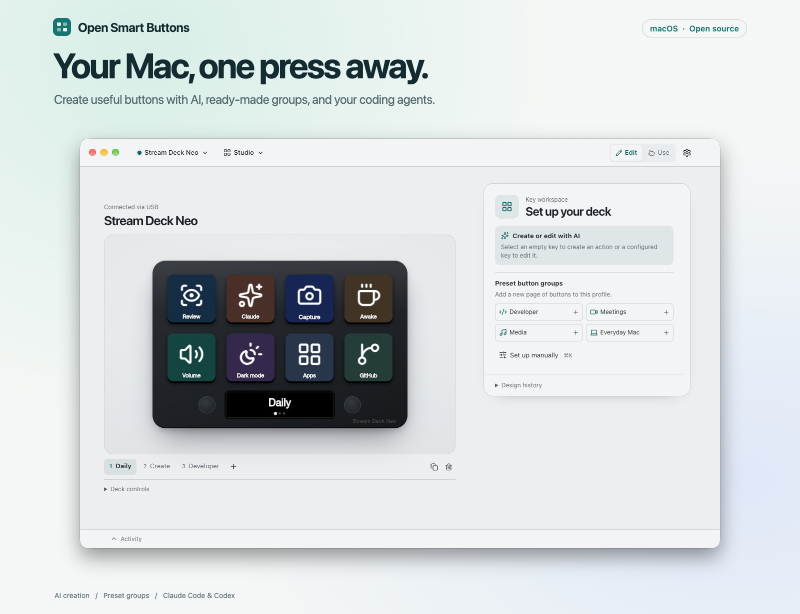
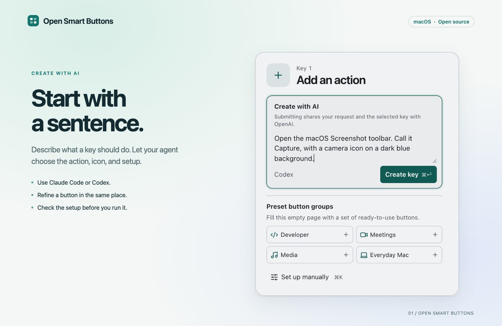
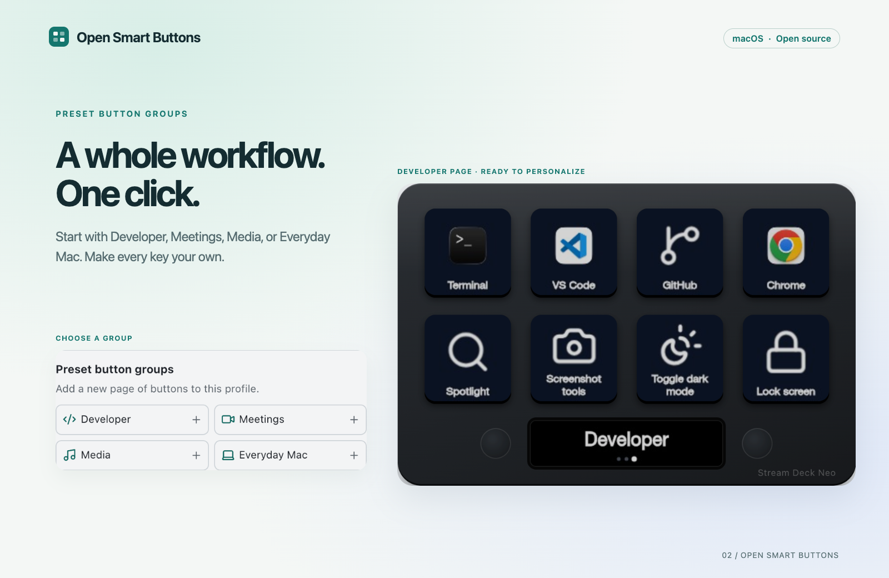
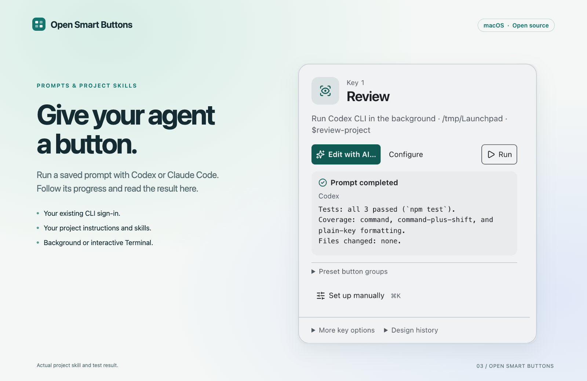
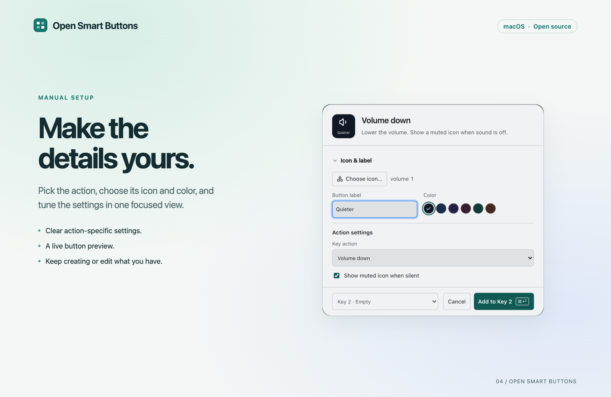

# Screenshots and capture plan

Five views tell the project's story: see the Mac app, describe a button, start with presets, run an agent, and customize the details. The README follows that order. The same assets can be used on a project landing page.

## Visual story

| View | Message and capture plan | Finished asset | Size |
| --- | --- | --- | --- |
| Workspace | “Your Mac, one press away.” Show the complete Daily page, the key workspace, and real Mac window controls. | [Light](images/screenshots/workspace-light.png) · [Dark](images/screenshots/workspace-dark.png) | 1600 × 1230 |
| Create with AI | “Start with a sentence.” Select an empty key and describe a useful action, including its icon and color. | [AI creation](images/screenshots/ai-create.png) | 1600 × 1040 |
| Preset groups | “A whole workflow. One click.” Show the group picker and the Developer page created through it. | [Preset groups](images/screenshots/presets.png) | 1600 × 1040 |
| Coding agent | “Give your agent a button.” Run a project skill and show its actual completed response. | [Agent prompt](images/screenshots/agent.png) | 1600 × 1040 |
| Manual setup | “Make the details yours.” Show a focused action dialog with its preview, icon, label, color and settings. | [Manual setup](images/screenshots/manual.png) | 1600 × 1040 |
| Repository preview | A readable title and recognizable Daily page at a smaller sharing size. | [Social preview](images/screenshots/social-preview.png) | 1280 × 640 |

The restrained mint, cream and lavender canvases share margins, typography and a teal accent. Captions sit outside the captured interface. The dark hero uses its own app capture and colors; the README selects it with a `<picture>` element when the reader prefers dark mode. Feature images use the light appearance for consistency and can be opened at full resolution.

## Gallery











## What was captured and checked

Captured on 8 November 2026 from the signed, packaged **Open Smart Buttons 0.1.0 Electron application on macOS**, with a physical Neo connected over USB. The hardware shown inside the interface is the application's device preview, not a photograph. An isolated public demo profile named **Studio** kept personal profiles, prompts, credentials and project paths out of the images.

- **AI creation:** the screenshot shows the request before submission. It was then submitted to Codex and saved as a **Capture** button using the built-in macOS Screenshot toolbar action. The application reported **Saved · Not run yet**. Creating the button did not run it.
- **Preset groups:** choosing **Developer** in the application created a page containing eight configured buttons. The displayed page is that result.
- **Agent prompt:** the application's **Run** control launched Codex with a project-local `$review-project` skill in a small public demo fixture. The skill ran three local tests and returned the result displayed in the screenshot: **all 3 tests passed; no files changed**. This was an actual run, not a mocked completion.
- **Manual setup:** the **Volume down** preset was opened through **Set up manually**, and its label was changed to **Quieter**. The image shows the unsaved setup dialog.
- **Restoration:** the isolated application was stopped, the normal app reopened, and the original saved profiles and preferences checked against their baseline.

The screenshots demonstrate these specific flows; they are not a substitute for the project's broader automated and physical-device tests. Claude Code is a supported option shown in the copy; the completed task pictured here used Codex.

## Reuse and refresh

The [original PNG captures](images/screenshots/raw/) retain the actual product pixels. Full-window captures include real macOS window controls; component captures come directly from the Electron renderer. No interface, connection status, permission, or agent output was painted into a screenshot. The presentation renderer adds only the surrounding canvas, headings and shadows.

To regenerate the presentation images from the checked-in originals, install the project's dependencies and Google Chrome, then run from the repository root:

```sh
node docs/images/screenshots/render.mjs
```

The renderer uses local fonts and blocks non-local page requests. It does not launch the application, access credentials, run agents, or change profiles. Recapture the originals from a current packaged app before illustrating a changed feature. Keep the demo data public, verify any result being shown, review both hero themes, and restore the user's app after capture. [Capture metadata](images/screenshots/capture.json) records the source-image dimensions and checksums.

The [social preview](images/screenshots/social-preview.png) is ready to upload in the GitHub repository's **Settings → General → Social preview**. It is supplied as an asset; repository settings are not changed by generating it. Keep the README's compatibility statement and [third-party notices](../THIRD_PARTY_NOTICES.md) with reused project material.
